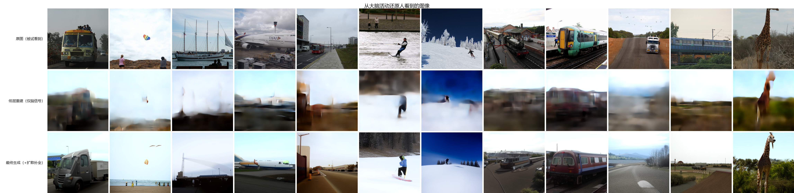

# 从大脑活动还原人看到的图像

> 让一个人看一张照片，只记录他大脑的活动，然后用计算机把这幅照片重新画出来。
> 这不是比喻：下面的「最终生成」一行，计算机从未接触过原图。
>
> 本仓库是《美不会绝迹——我的审美手记》的素材附录，用于公开查看项目结果与复现细节。

三行分别是：**原图**（被试真实看到）／**低层重建**（仅由脑信号解出）／**最终生成**（扩散模型补全细节）。

---

## 一、实验是怎么做的

1. 志愿者躺进一台 **7 特斯拉 fMRI** 扫描仪，连续观看约 10,000 张自然照片（NSD 公开数据集），每张闪现数秒。
2. 机器记录他视觉皮层（nsdgeneral 区域）**一万多个体素**的血氧信号强度。
3. 于是得到大量配对：（一张照片）↔（看它时的脑信号）。
4. 训练模型学习这个对应关系；训练完成后，给一份**从未见过**的脑信号，让它推断"这个人刚才大概看到了什么"。

## 二、技术流程（通俗版）

| 步骤 | 做什么 | 输出 |
|---|---|---|
| 1 | 脑信号标准化：每个体素减去均值、除以波动 → 一万多个数字 | 这一瞬间的全部信息 |
| 2 | 用 CLIP 把图像转成 768 维语义指纹，训练模型从脑信号预测它 | "读懂了在看什么" |
| 3 | 另一个小模型直接输出 64×64 布局草图，交给编解码器还原成 512×512 | 模糊但位置正确的"低层重建" |
| 4 | 以语义指纹为条件、以模糊图为起点，用扩散模型补细节 | "最终生成" |
| 5 | 与原图做六项指标比较 | 见下表 |

## 三、结果

测试集为 982 张被试看过、但模型训练时从未见过的照片。

| 指标 | 本项目 | 原论文 MindEye | 判断 |
|---|---|---|---|
| 像素相关性 PixCorr | **0.414** | 0.390 | 超过 |
| 结构相似度 SSIM | **0.363** | 0.337 | 超过 |
| AlexNet 浅层 | 97.3% | 97.4% | 持平 |
| AlexNet 中层 | 98.2% | 98.7% | 持平 |
| Inception 语义 | 93.4% | 94.5% | 略低 |
| EffNet 特征距离 | 0.743 | 0.630 | 落后 |

六项里两项超过、三项持平、一项落后。

**一个补充**：原论文使用 8 张高端服务器显卡训练；本项目全部工作在**一张 8 GB 显存的笔记本显卡**上完成。

## 四、必须说明的局限

1. 只训练了**一个被试**，模型不能直接套用到别人身上。
2. 这是**复现**工作，方法来自 2023 年的 MindEye；贡献在于用廉价硬件重现，并系统检验哪些设计真的有用。
3. 生成图不是"照片级还原"，更像"根据脑信号画的一幅内容吻合、笔触自由的插图"。
4. 六项指标全部**对整体亮度／对比度不敏感**。我们曾遇到"指标正常但图像严重发灰"，最后是靠人眼发现的——这说明自动评分不能完全代表观感。

## 五、为什么这算"科学之美"

- **自然之美**：人看到的世界，被精确地写进了神经活动里。
- **还原之美**：一串数字，能重新长回一幅图像。
- **认知之美**：我们第一次可以"向外看"自己看见世界的过程。

视觉不是眼睛的功能，而是大脑的构造。而我们，正在学会读这份构造。

---

## 文件说明

| 路径 | 内容 |
|---|---|
| `对比图_best_n12.png` | 12 个样本 × 三行总览 |
| `对比图_spread_n12.png` | 同为总览，按指标分布挑选的样本 |
| `单行_1_原图_*.png` / `单行_2_低层重建_*.png` / `单行_3_最终生成_*.png` | 单行的分隔版本，便于排版 |
| `单例/` | 27 个单独样本的三行拼图 |
| `生成对比图.py` | 生成上述对比图的脚本 |
| `项目说明.txt` | 面向非技术读者的原始说明 |

## 参考

- Scotti et al., *MindEye: Reconstructing the Mind's Eye*, 2023.
- Allen et al., *A massive 7T fMRI dataset (NSD) to bridge cognitive neuroscience and AI*, Nature Neuroscience, 2022.
